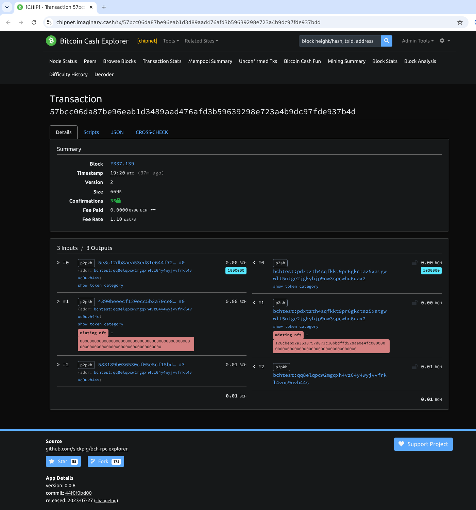
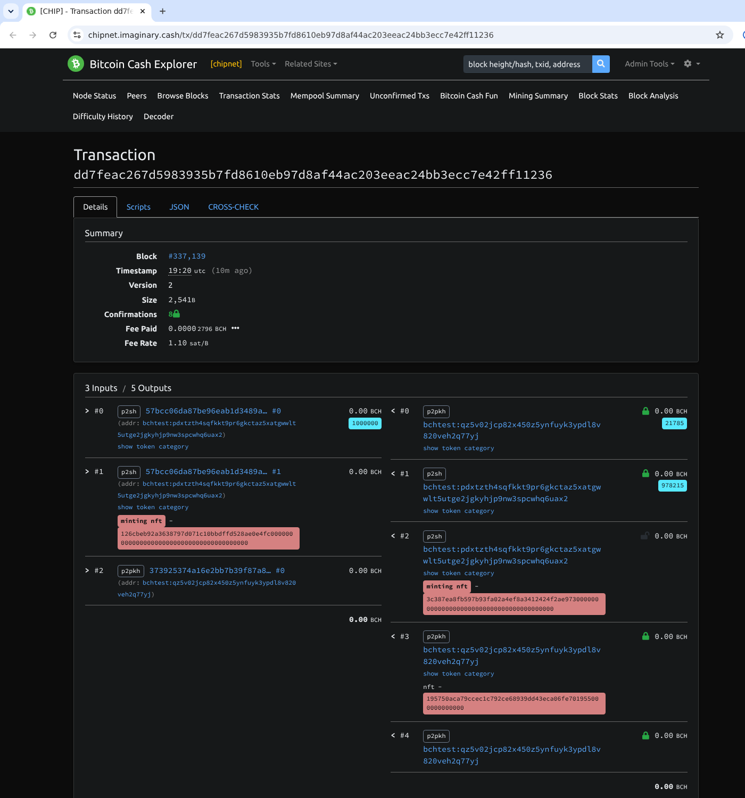
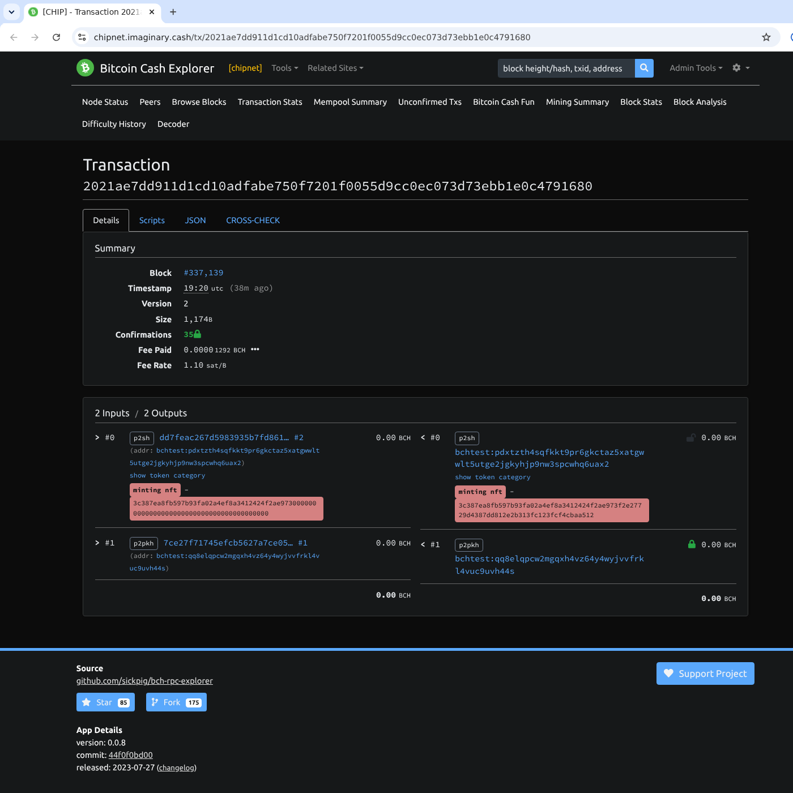
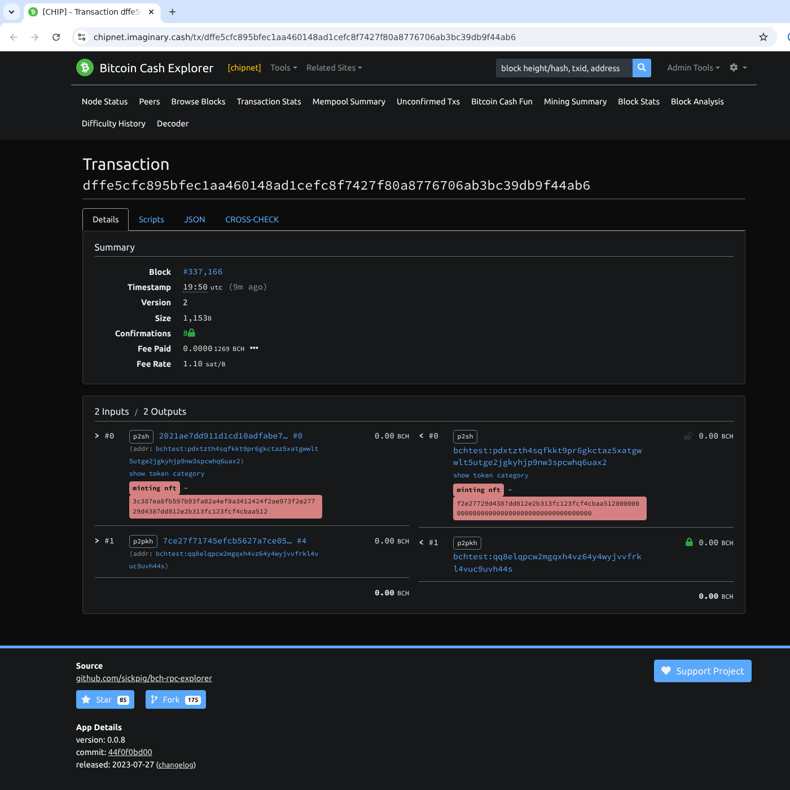
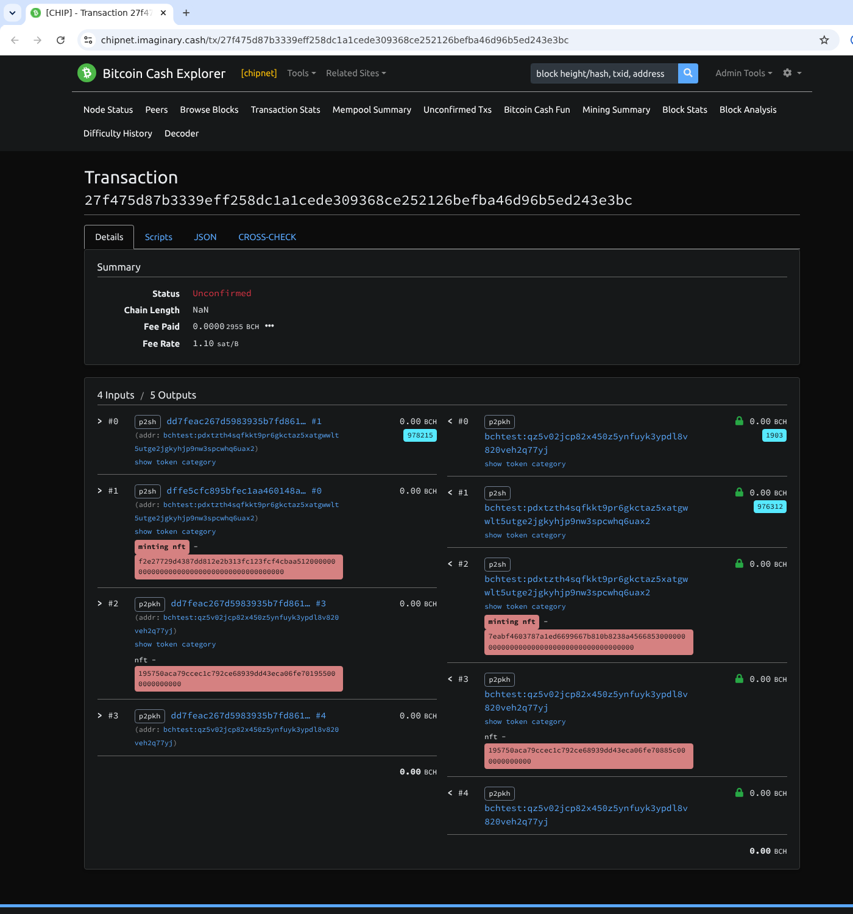

# Chipnet demo — every transaction, command and rejection

Everything below is a real Chipnet transaction. Nothing is fabricated; every txid
can be opened at `https://chipnet.imaginary.cash/tx/<txid>` and the screenshots
in [`docs/explorer/`](explorer/) were taken from those pages.

Wallet: `bchtest:zq8elqpcw2mgqxh4vz64y4wyjvvfrkl4vul00jen2r` (operator,
`m/44'/145'/0'/0/0` of a disposable Chipnet mnemonic stored outside this repo).
Demo users 1..300 are `m/44'/145'/0'/0/<n>` of the same mnemonic: this is a
testnet convenience so one process can play operator and users; every claim is
still signed with that user's own key and pays that user's own address.

## 1. Funding, token genesis, pool deployment

| step | txid | what it shows |
|---|---|---|
| faucet | `db79ac032570b6eb107b0226f53d06d7b5dc3ce3135680d5b82d674b1a21952e` | 2,000,000 Chipnet sats from the BCH Ninja PoW faucet |
| split | `7ce27f71745efcb5627a7ce054368e7f8adf92a38314f3bfc9b831c1c0a43e5f` | 6 × 60,000 sats (genesis inputs need `vout 0`) |
| split | `583189b036530cf05e5cf15bd1be7add4a0055c20fa4cdeb0f022fdb42384e97` | second batch, so the two genesis txs use different outpoints |
| genesis: FLDCH stand-in | `5e8c12db8aea53ed81e644f72a11fe2e390f9271a78be948126a375a5fa3492e` | mints 1,000,000 units of category `7ce27f71…43e5f` (the category is the first input's outpoint txid, per the CashTokens genesis rule) |
| genesis: receipt/state NFT category | `4390beeecf120ecc5b3a70ce850ed1e63f74a0b258be1d6b4f0e30e271d08a39` | mints one **minting** NFT of category `583189b0…84e97` with a 40-byte commitment |
| **deploy pool** | `57bcc06da87be96eab1d3489aad476afd3b59639298e723a4b9dc97fde937b4d` | moves both into the pool address and commits **epoch-1 root `126cbeb92a3638797d071c10bbdffd528ae0e4fc`** (`activeRoot ‖ 0…0`) |
| fund demo users | `373925374a16e2bb7b39f87a81e26321167da9ad42fc9d9fb1c9293df55bc53f` | 3 × 15,000 sats so users pay their own claim fees |



The deploy transaction shows the two pool UTXOs: 1,000,000 reward tokens and the
minting NFT with commitment `126cbeb9…0000000000000000000000000000000000000000`.

Mapping to the real token: on mainnet FLDCH is category
`0adb865ee9cc3038de87fba682e6cd361414edc9acff0da2fd0690d75341c640`, which
nobody can mint NFTs in. The demo therefore uses one new category as the FLDCH
stand-in (the pool's reward balance) and a second new category for the state and
receipt NFTs — exactly the two-category structure a production deployment would
have (`rewardCategory` = FLDCH, `receiptCategory` = a category FoldingCash mints
at deployment).

## 2. Epoch 1: a user claims

Tree: 300 leaves from `demo/epochs/epoch-1.csv`, depth 9, root
`126cbeb92a3638797d071c10bbdffd528ae0e4fc`.

```bash
npm run claim -- 1
```

| step | txid | detail |
|---|---|---|
| **claim (first)** | `dd7feac267d5983935b7fd8610eb97d8af44ac203eeac24bb3ecc7e42ff11236` | 21,785 units to `bchtest:zz5v02…7scmp`; receipt NFT minted with commitment `195750ac…fe70 1955000000000000` (= addrHash ‖ 21,785); pool root becomes `3c387ea8…e973`; 2541 bytes, fee 2,796 sats |



## 3. Double claim: two independent rejections

```bash
npm run reject:double -- 1 dd7feac267d5983935b7fd8610eb97d8af44ac203eeac24bb3ecc7e42ff11236
```

```
user 1 bchtest:zz5v02jcp82x450z5ynfuyk3ypdl8v820v7ae7scmp
  stale proof: earned=21785 claimed=0
  current on-chain root: 3c387ea8fb597b93fa02a4ef8a3412424f2ae973
  root the stale proof rebuilds: 126cbeb92a3638797d071c10bbdffd528ae0e4fc

(a) local VM evaluation of the replay:
  REJECTED: RewardPool.cash:85 Require statement failed at input 0 in contract RewardPool,
            function claimChecks (RewardPool.cash, line 85) with the following message:
            proof does not match active root.

(b) the same replay handed directly to a Chipnet node:
  REJECTED: the transaction was rejected by network rules.

(c) rebroadcasting the exact original transaction (idempotent by txid):
  node returned the same txid dd7feac2…11236 — identical bytes cannot be mined twice
```

The interesting one is (a): the covenant rejects it *before* any receipt logic,
because the claim's second Merkle walk rebuilt the old root and the pool no
longer commits to it. (b) is the same transaction submitted to the node without
the local check, rejected by the network's own script validation.

## 4. Epoch 2: rotation and the audit window

`npm run next-epoch` rebuilds the leaf set with the claimed totals **read back
from the chain** (user 1: `earned 23688, claimed 21785`), so the new root is
consistent with what users actually withdrew.

| step | txid | detail |
|---|---|---|
| **propose epoch 2** | `2021ae7dd911d1cd10adfabe750f7201f0055d9cc0ec073d73ebb1e0c4791680` | commitment `3c387ea8… ‖ f2e27729d4387dd812e2b313fc123fcf4cbaa512`; claims pause |
| early activation attempt | *(rejected)* | see below |
| **activate epoch 2** | `dffe5cfc895bfec1aa460148ad1cefc8f7427f80a8776706ab3bc39db9f44ab6` | commitment `f2e27729… ‖ 0…0`; claims resume |

```bash
npm run propose
npm run reject:early
```

```
pending root : f2e27729d4387dd812e2b313fc123fcf4cbaa512
pending UTXO : 2021ae7dd911d1cd10adfabe750f7201f0055d9cc0ec073d73ebb1e0c4791680:0
chain height : 337137
audit delay  : 2 blocks (BIP68 relative locktime)

local VM evaluation: passed (the VM only sees the sequence field, not UTXO age)

Chipnet node verdict on the early activation:
  REJECTED: BIP68 sequence lock not satisfied: the transaction was rejected by network rules.
```

The script deliberately builds a *correctly signed* activation with the right
sequence number; the only thing wrong is that the pending UTXO is not old enough.
The node refuses it, which is the timelock doing its job. `npm run
activate:when-ready` then retries until the network accepts it
(`dffe5cfc…f44ab6`, block 337166).




The activation screenshot shows the commitment changing from
`3c387ea8…f2e27729` (active ‖ pending) to `f2e27729…0000`.

## 5. Epoch 2: claiming the delta with the receipt NFT

```bash
npm run claim -- 1
```

| step | txid | detail |
|---|---|---|
| **claim (with receipt)** | `27f475d87b3339eff258dc1a1cede309368ce252126befba46d96b5ed243e3bc` | 1,903 units (23,688 − 21,785); 4 inputs (pool reward, pool state, receipt, funding); receipt re-minted with commitment `… 885c000000000000` (= 23,688) |



Replaying *this* proof is rejected the same way (run `FC_EPOCH=2 npm run
reject:double -- 1 27f475d8…`).

## 6. Watcher: the root is fully explained by the chain

```bash
npm run sync -- 2
```

```
epoch 2: replaying claims from bchtest:pdxtzth4sqfkkt9pr6gkctaz5xatgwwlt5utge2jgkyhjp9nw3spcwhq6uax2
  claims found on chain: 3
  published root        : f2e27729d4387dd812e2b313fc123fcf4cbaa512
  recomputed root       : 876efe257df8899ae9128eb40bfe700567942ff1
  on-chain active root  : 876efe257df8899ae9128eb40bfe700567942ff1
  MATCH: the committed root is fully explained by the published leaves and the claim history
```

`sync.ts` starts from the published leaf snapshot and replays every claim it
decodes from the pool address' transaction history (the leaf address, the paid
amount and the new cumulative total are all recoverable from a claim's outputs).
If the operator published a root that does not follow from the chain, this fails
loudly. The same logic backs `GET /watch` on the proof server.

## 7. Proof server

```bash
npm run serve -- 8710
curl localhost:8710/
curl localhost:8710/proof/bchtest:zz5v02jcp82x450z5ynfuyk3ypdl8v820v7ae7scmp
curl localhost:8710/watch
```

```
{
  "contract": "bchtest:pdxtzth4sqfkkt9pr6gkctaz5xatgwwlt5utge2jgkyhjp9nw3spcwhq6uax2",
  "epoch": 1, "leaves": 300, "claimsApplied": 1,
  "activeRoot": "3c387ea8fb597b93fa02a4ef8a3412424f2ae973",
  "pendingRoot": "f2e27729d4387dd812e2b313fc123fcf4cbaa512",
  "claimsPaused": true, "rewardBalance": "978215",
  "watcher": "root matches chain"
}
```

The server rebuilds the live tree on each request from the published snapshot plus
the claim history, so it always serves proofs against the root that is actually
committed, and `claimable` reflects what the user has already withdrawn.

## 8. Operator push path (delegated receipt)

| step | txid | detail |
|---|---|---|
| user 2 claims (epoch 2) | `69650499b8c89b9814989b43e0561dd24cd11b9c90dd58f457f1369f94178f78` | 158,696 units + receipt `36b3fc17…c9e86b02` |
| user 2 delegates the receipt | `11104ccfdc24cf0e8750ba2567afec23f956ffb26228b70f21dea22ca041f589` | receipt moved to the `ReceiptHold` covenant (`minPush = 100`) |
| epoch 3 proposed | `4338366ec224fe565f0801064c966de537d6051646300a3d54bc58e437550bff` | root `776b6e07a872fe8ffbc314e789ab37bf8e059f8c`, user 2 outstanding = 11,050 |
| epoch 3 activated | *(see transactions.jsonl)* | |
| **operator push** | *(see transactions.jsonl)* | the operator pays the fee and dust, the user receives 11,050 units, the receipt stays delegated |

The push is a normal claim whose receipt input is unlocked by
`ReceiptHold.delegated(operatorSig)` instead of the user's key. Three things keep
it safe: the pool can only pay the address committed in the leaf, the receipt must
return to the same delegation, and the recorded total must grow by at least
`minPush` — otherwise the covenant rejects the push.

## Reproducing the numbers

`npm run cost` and `npm run depth` regenerate the cost table and the
depth/VM-limit table from measured transaction sizes; `npm test` re-runs every
contract branch through libauth's BCH VM. See [COST.md](COST.md) and
[ARCHITECTURE.md](ARCHITECTURE.md).
